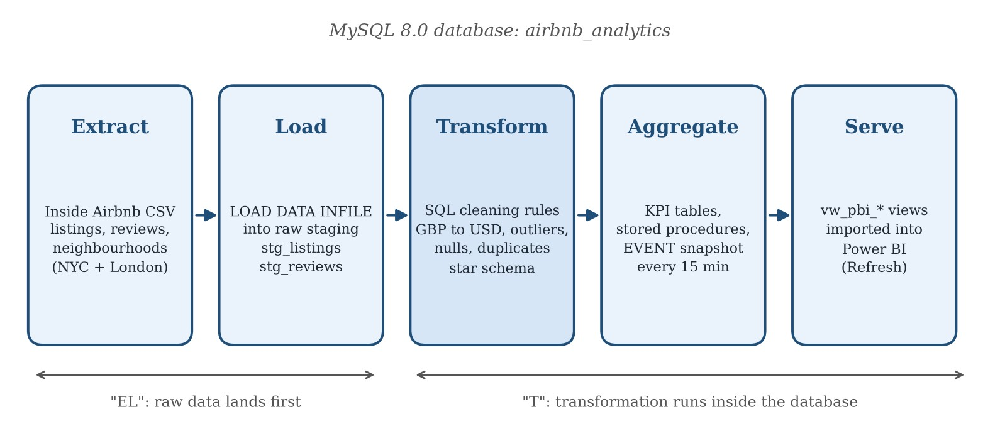
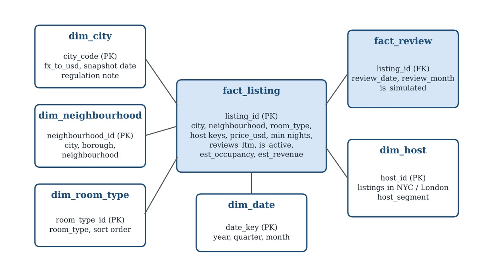
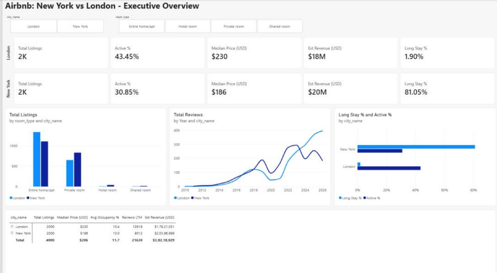
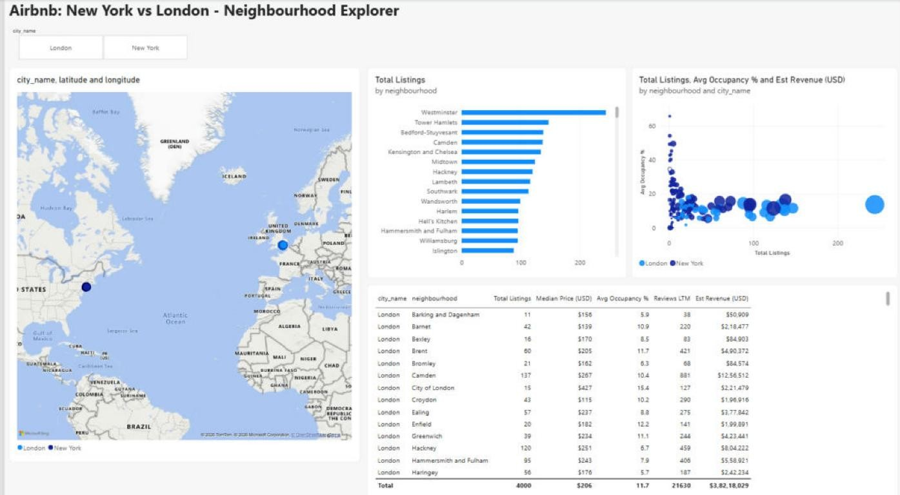
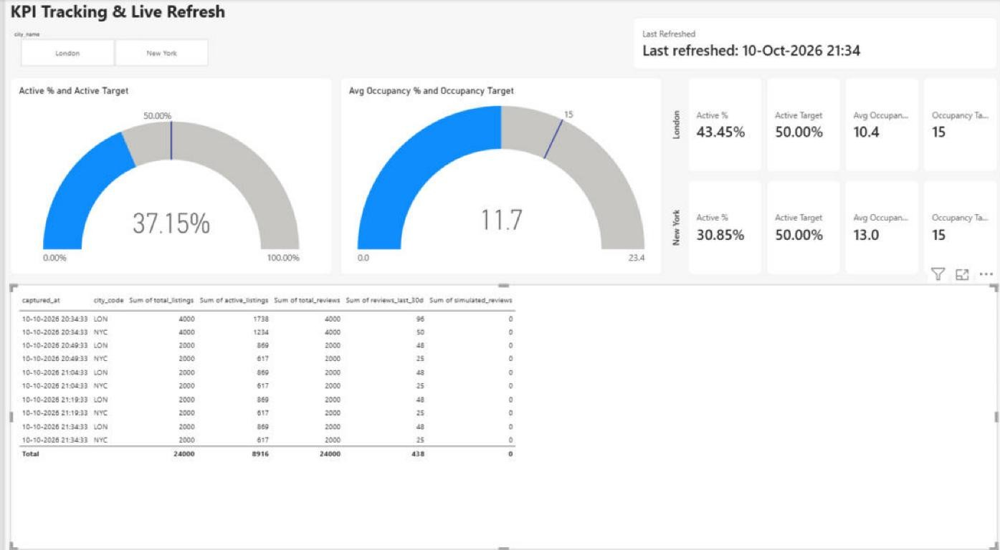

# Airbnb New York vs London: ELT Pipeline, SQL KPI Engine & Power BI Dashboard

An end-to-end analytics project comparing Airbnb's New York and London markets. Public Inside Airbnb data is loaded into MySQL through an ELT pipeline, cleaned into a star schema, analysed with 16 SQL queries and stored procedures, refreshed on a schedule, and explored in a four-page Power BI dashboard.

*Individual project, MBA Business Analytics: Business Decision Intelligence.*

## Business scenario
A regional strategy team at Airbnb needs one place to answer: are our two biggest English-speaking city markets healthy, and where should we focus next? That means knowing how much supply is genuinely active, how regulation (New York's Local Law 18, London's 90-night cap) is changing demand, and which hosts and neighbourhoods carry the business.

## Architecture



1. **Extract and load:** raw Inside Airbnb CSVs land in all-text staging tables, so nothing is rejected at load time.
2. **Transform:** 12 data-quality rules, each logged with its row count in a `data_quality_log` table. Missing prices and prices above the city's 99th percentile are flagged, not deleted; minimum stays are capped at 365; missing values are filled; text is cleaned. London prices are converted to USD (1 GBP = 1.3371 USD), and the cleaned data is loaded into a star schema. Every business assumption lives in a parameter table, not in code.
3. **Analyse:** 16 queries, 9 stored procedures and Power BI views.
4. **Refresh:** a MySQL event captures a KPI snapshot every 15 minutes and a nightly event rebuilds everything. A simulation procedure feeds synthetic new reviews to demonstrate the live refresh.



Fact tables `fact_listing` and `fact_review`; dimensions `dim_city`, `dim_neighbourhood`, `dim_host`, `dim_room_type` and `dim_date`.

## SQL techniques
| Technique | Used for |
|---|---|
| Multi-table joins | Borough and city scorecards |
| Conditional aggregation (pivot) | Room-type mix by city |
| CTEs + `ROW_NUMBER` | Median nightly price |
| `LAG`, rolling 12-month sums | Demand trend around Local Law 18 |
| `NTILE` | Host concentration, price quartiles |
| Running totals | Revenue Pareto by neighbourhood |
| Prepared statements | One report, any city / room type / price band |
| Stored procedures with whitelisted dynamic SQL | Self-service rankings, e.g. `CALL sp_top_areas('LON', 'revenue', 10)` |

## Power BI dashboard
Four pages: Executive Overview, Neighbourhoods (map, ranking, opportunity scatter), a Neighbourhood Detail drill-through page, and KPI Tracking with targets, gauges and the 15-minute snapshot log. Slicers, drill-down and drill-up throughout.







## Key findings (full dataset, September 2026)
| Indicator | New York | London |
|---|---|---|
| Listings | 29,918 | 91,954 |
| Active listings | 31.0% | 43.3% |
| Median nightly price (USD) | 182 | 234 |
| Listings requiring 30+ night stays | **80.7%** | 2.1% |
| Reviews per listing, last 12 months | 4.9 | 6.4 |
| Estimated revenue, last 12 months | $316.6M | $795.7M |
| Revenue per active listing | ~$34,200 | ~$20,000 |

- **Headline supply is inflated:** only 31% (NYC) and 43% (London) of listings are truly active; a third of New York listings are dormant.
- **Regulation reshaped New York:** after Local Law 18, 80.7% of listings require 30+ night stays and 12-month review volume fell by a third before starting to recover.
- **Concentration:** in both cities the largest 10% of hosts hold about 45% of listings.

## Recommendations (selected)
1. **New York:** build a mid-term (30+ night) product for corporate and relocation guests; contact the 757 unlicensed short-stay hosts.
2. **London:** protect the core boroughs (Westminster, Camden, Kensington & Chelsea) that drive most revenue.
3. **Both:** reactivate or hide dormant listings; run an account-management programme for the top 10% of hosts.

## What's in this repository
```
├── sql/
│   └── airbnb_nyc_london_pipeline.sql       # Complete pipeline: scripts 00–06 in one file
├── powerbi/
│   └── airbnb_nyc_london_dashboard.pbix     # Dashboard (built on the sample data below)
├── data/                                    # 2,000-row samples per city
│   ├── nyc_listings.csv · london_listings.csv
│   ├── nyc_reviews.csv · london_reviews.csv
│   └── nyc_neighbourhoods.csv · london_neighbourhoods.csv
├── images/                                  # Figures used in this README
└── reports/
    ├── report.pdf                           # Full project report
    └── presentation.pptx
```

**Data note:** the findings above come from the full snapshot (121,872 listings, 3.32M reviews and ~44.5M calendar rows), which is far too large for GitHub. `data/` holds 2,000-listing samples per city; the Power BI file is built on these, so its totals are smaller than the report's. To reproduce the report, download the September 2026 New York and London files (`listings.csv`, `reviews.csv`, `neighbourhoods.csv`, `calendar.csv`) from [Inside Airbnb](https://insideairbnb.com/get-the-data/), save them in `data/` with the file names used in the script, and run it.

## How to run
```bash
# once, as root:  SET GLOBAL local_infile = 1;
mysql --local-infile=1 -u root -p < sql/airbnb_nyc_london_pipeline.sql
```
Run from the repository root (the script loads files from `data/`). Needs MySQL 8.0+ with the event scheduler on. Then open the `.pbix` in Power BI Desktop and point the MySQL connection at your server.

## Data source
[Inside Airbnb](https://insideairbnb.com), licensed CC BY 4.0. New York snapshot 14 Sep 2026, London 17 Sep 2026.

## Tech stack
MySQL 8 · Power BI (DAX) · ELT · star schema
